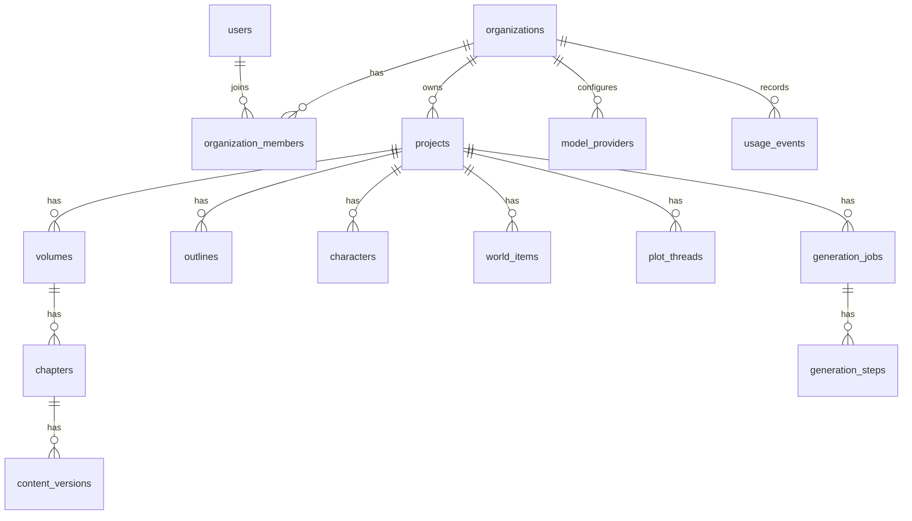

# AI 创作小说 SaaS 平台设计文档

> 日期：2026-04-29  
> 阶段：产品与技术设计  
> 定位：面向独立网文作者和小团队的结构化小说创作工作台  
> 参考：`oh-story-claudecode` 的写作 skill 流程、Linux.do 上 InkWell Ai 的工作台实践

## 1. 背景与目标

本平台不是单纯的“AI 聊天写小说”，而是一个结构化创作 SaaS。它把一部小说拆成可管理的作品资产：作品定位、大纲、角色、世界观、章节、上下文记忆、伏笔、版本和生成任务。AI 作为写作助手，围绕这些资产执行选题、拆解、生成、续写、改写、润色、去 AI 味和审稿。

第一版目标是帮助独立网文作者和小团队稳定完成长篇连载，同时保留短篇故事/爆款文工具入口。用户可以自带 API Key，也可以使用平台托管模型额度。

## 2. 产品原则

1. 半自动优先：用户负责方向判断，AI 负责生成草稿和辅助修改。
2. 结构化优先：作品资产必须沉淀到数据库，不依赖一次性对话上下文。
3. 长篇连续性优先：章节生成必须引用角色、世界观、大纲、前文摘要和伏笔状态。
4. 可回滚优先：AI 生成、重写、审稿和修复都要保留版本。
5. 成本可见：token、模型、任务耗时和失败原因必须能追踪。
6. SaaS 可运营：从第一天支持账号、团队、权限、用量、模型配置和审计。

## 3. MVP 范围

### 3.1 必做能力

- 账号注册、登录、组织/团队空间。
- 作品库：创建作品，设置题材、受众、风格、目标字数、更新频率和模型偏好。
- 创作工作台：左侧资产树，中间章节编辑器，右侧 AI 助手和生成参数。
- 资料库：角色卡、世界观、地点、势力、物品、伏笔和禁忌设定。
- 大纲系统：全书大纲、分卷大纲、章节大纲。
- 章节系统：章节正文、草稿/定稿状态、版本历史、字数统计。
- AI 生成管线：大纲生成、角色生成、世界观生成、章节生成、续写、重写、润色、去 AI 味、审稿。
- 任务中心：异步任务状态、流式输出、失败重试、取消、历史记录。
- 模型配置：用户自带 API Key 和平台托管模型两种模式。
- 用量统计：按组织、作品、任务、模型统计 token、费用估算和耗时。

### 3.2 暂不做但预留

- 全自动批量写完整本书：后续可做“批量生成草稿”，但第一版不作为核心。
- 复杂社区：第一版只保留模板/案例扩展点，不做完整社区。
- 版权交易：先记录作品归属和导出历史，不做合同和交易系统。
- 编辑多人审批流：第一版只做基础团队权限和评论，不做重型审批。
- 公开小说发布站：先做私有预览/分享链接，不做读者端平台。

## 4. 用户角色与权限

### 4.1 角色

- 个人作者：创建和管理自己的作品。
- 团队所有者：管理组织、成员、账单、模型 Key。
- 协作者：参与指定作品的编辑和资料维护。
- 只读成员：查看作品、评论、导出，但不能修改正文和配置。
- 平台管理员：处理风控、套餐、系统模型、异常任务和用户支持。

### 4.2 权限模型

权限使用组织级角色加作品级覆盖：

- 组织角色：`owner`、`admin`、`member`、`viewer`。
- 作品权限：`project_owner`、`editor`、`commenter`、`viewer`。
- 数据访问必须始终带 `organization_id`，所有业务表都通过组织隔离。

## 5. 信息架构

### 5.1 主导航

1. 作品库：所有作品、最近编辑、归档作品、模板入口。
2. 创作工作台：围绕单部作品进行大纲、资料和章节创作。
3. 资料库：跨作品模板、角色模板、世界观模板、风格模板。
4. 生成中心：任务队列、失败任务、历史生成、用量统计。
5. 账户与模型：团队、API Key、套餐、账单、安全设置。

### 5.2 创作工作台布局

- 左栏：作品结构树。包含大纲、卷、章节、角色、世界观、伏笔和资料条目。
- 中栏：当前编辑对象。章节正文使用富文本/Markdown 混合编辑器，资料卡使用结构化表单。
- 右栏：AI 面板。包含动作按钮、模型选择、上下文引用、生成参数、任务进度和审稿建议。

这是工作型 SaaS，不做营销页式大卡片堆叠。界面应高密度、可扫描、焦点态清晰，适合长时间写作。

## 6. 核心写作流程

### 6.1 长篇连载流程

### 6.2 短篇故事流程

短篇入口不单独做复杂工作台。它复用作品、章节、生成任务和版本系统，但界面更轻：

`题材/情绪目标 -> 反转设计 -> 短篇大纲 -> 正文 -> 精修 -> 导出`

### 6.3 AI 动作

- 生成作品定位：根据题材、读者、平台风格生成卖点和风险点。
- 生成/重写大纲：生成全书、分卷或章节大纲。
- 生成角色卡：生成角色基本资料、动机、关系、成长线和禁忌行为。
- 生成世界观：生成规则、地点、势力、物品、等级体系。
- 生成章节正文：根据章节大纲、角色、世界观、前文摘要和伏笔生成。
- 续写：基于当前正文光标位置和上下文继续写。
- 重写：按用户指导语重写章节或片段。
- 润色：改善节奏、对白、描写、爽点和情绪。
- 去 AI 味：替换高频 AI 表达、降低排比、减少空泛总结。
- 审稿：检查人设冲突、设定冲突、主线偏移、节奏问题和毒点。

## 7. AI 生成管线设计

### 7.1 管线原则

每个 AI 动作都不是单次裸请求，而是一个管线：

1. 读取用户输入和当前编辑对象。
2. 选择上下文：作品定位、大纲、角色、世界观、前文摘要、伏笔和禁忌设定。
3. 压缩上下文：按任务类型选择必要片段，避免 token 浪费。
4. 组装提示词：系统提示词、任务提示词、用户指导语、结构化输出要求。
5. 调用模型：支持流式输出、超时、重试、取消和模型回退。
6. 解析输出：正文、结构化 JSON、审稿报告或修订建议。
7. 写入版本：生成结果先作为草稿版本，不直接覆盖用户定稿。
8. 后处理：统计 token、更新摘要、抽取角色/伏笔变化、写审计日志。

### 7.2 管线节点

- `context_select`：选择上下文。
- `context_compress`：压缩和排序上下文。
- `prompt_build`：构建提示词。
- `model_call`：调用模型。
- `output_parse`：解析模型输出。
- `quality_review`：质量审查。
- `memory_extract`：抽取新增事实、角色变化和伏笔变化。
- `persist_version`：保存版本和任务产物。

### 7.3 任务并发

- 同一作品默认只允许一个正文生成任务运行，避免章节上下文被并发污染。
- 资料生成、审稿、统计类任务可以并行，但必须通过任务锁控制写入对象。
- 长任务使用心跳和租约机制，避免任务崩溃后永久锁死。
- Web 前端使用 WebSocket 或 SSE 接收进度；MVP 可先用 SSE，后续升级 WebSocket。

## 8. 数据模型设计

### 8.1 设计原则

- 数据库建议使用 PostgreSQL。
- 所有用户内容表都包含 `organization_id`，支持租户隔离。
- 正文和长文本可存 PostgreSQL `text`，大附件和导出文件走对象存储。
- 结构化字段使用普通列，灵活扩展字段使用 `jsonb`。
- AI 生成结果必须版本化，不能直接覆盖用户内容。
- 软删除用于用户资产，硬删除只用于临时任务片段和过期缓存。

### 8.2 实体关系总览

### 8.3 账号与组织

#### users

用户主表。

| 字段 | 类型 | 说明 |
| --- | --- | --- |
| id | uuid pk | 用户 ID |
| email | citext unique | 邮箱 |
| display_name | varchar(80) | 昵称 |
| avatar_url | text nullable | 头像 |
| password_hash | text nullable | 邮箱密码登录时使用 |
| status | varchar(20) | `active`、`disabled`、`deleted` |
| locale | varchar(20) | 默认 `zh-CN` |
| timezone | varchar(50) | 默认 `Asia/Shanghai` |
| created_at | timestamptz | 创建时间 |
| updated_at | timestamptz | 更新时间 |

索引：

- `unique(email)`
- `idx_users_status(status)`

#### user_identities

第三方登录身份。

| 字段 | 类型 | 说明 |
| --- | --- | --- |
| id | uuid pk | 身份 ID |
| user_id | uuid fk | 用户 |
| provider | varchar(40) | `github`、`linux_do`、`google` 等 |
| provider_user_id | varchar(160) | 第三方用户 ID |
| provider_email | citext nullable | 第三方邮箱 |
| raw_profile | jsonb | 原始资料快照 |
| created_at | timestamptz | 创建时间 |

索引：

- `unique(provider, provider_user_id)`
- `idx_user_identities_user(user_id)`

#### organizations

组织/团队空间。

| 字段 | 类型 | 说明 |
| --- | --- | --- |
| id | uuid pk | 组织 ID |
| name | varchar(120) | 组织名 |
| slug | varchar(80) unique | URL 标识 |
| plan_code | varchar(40) | 套餐 |
| billing_mode | varchar(20) | `byok`、`platform`、`hybrid` |
| owner_user_id | uuid fk | 所有者 |
| status | varchar(20) | `active`、`suspended`、`deleted` |
| settings | jsonb | 团队偏好 |
| created_at | timestamptz | 创建时间 |
| updated_at | timestamptz | 更新时间 |

索引：

- `unique(slug)`
- `idx_organizations_owner(owner_user_id)`

#### organization_members

组织成员。

| 字段 | 类型 | 说明 |
| --- | --- | --- |
| id | uuid pk | 成员记录 |
| organization_id | uuid fk | 组织 |
| user_id | uuid fk | 用户 |
| role | varchar(20) | `owner`、`admin`、`member`、`viewer` |
| status | varchar(20) | `active`、`invited`、`removed` |
| joined_at | timestamptz nullable | 加入时间 |
| created_at | timestamptz | 创建时间 |

索引：

- `unique(organization_id, user_id)`
- `idx_org_members_user(user_id)`
- `idx_org_members_org_role(organization_id, role)`

#### invitations

团队邀请。

| 字段 | 类型 | 说明 |
| --- | --- | --- |
| id | uuid pk | 邀请 ID |
| organization_id | uuid fk | 组织 |
| email | citext | 被邀请邮箱 |
| role | varchar(20) | 邀请角色 |
| token_hash | text | 邀请 token 哈希 |
| expires_at | timestamptz | 过期时间 |
| accepted_at | timestamptz nullable | 接受时间 |
| created_by | uuid fk | 邀请人 |
| created_at | timestamptz | 创建时间 |

### 8.4 作品与权限

#### projects

作品主表。

| 字段 | 类型 | 说明 |
| --- | --- | --- |
| id | uuid pk | 作品 ID |
| organization_id | uuid fk | 组织 |
| title | varchar(160) | 作品名 |
| slug | varchar(120) | 组织内唯一标识 |
| type | varchar(20) | `long_novel`、`short_story` |
| genre | varchar(80) | 题材 |
| target_audience | varchar(120) | 目标读者 |
| platform_target | varchar(80) nullable | 起点、番茄、晋江等 |
| style_brief | text | 文风说明 |
| premise | text | 核心创意 |
| selling_points | jsonb | 核心卖点 |
| target_word_count | integer | 目标字数 |
| update_cadence | varchar(40) | 更新频率 |
| status | varchar(20) | `draft`、`active`、`paused`、`archived` |
| default_model_profile_id | uuid nullable | 默认模型配置 |
| settings | jsonb | 作品配置 |
| created_by | uuid fk | 创建人 |
| created_at | timestamptz | 创建时间 |
| updated_at | timestamptz | 更新时间 |
| deleted_at | timestamptz nullable | 软删除 |

索引：

- `unique(organization_id, slug)`
- `idx_projects_org_status(organization_id, status)`
- `idx_projects_updated(organization_id, updated_at desc)`

#### project_members

作品级成员权限。

| 字段 | 类型 | 说明 |
| --- | --- | --- |
| id | uuid pk | 记录 ID |
| organization_id | uuid fk | 组织 |
| project_id | uuid fk | 作品 |
| user_id | uuid fk | 用户 |
| role | varchar(20) | `project_owner`、`editor`、`commenter`、`viewer` |
| created_at | timestamptz | 创建时间 |

索引：

- `unique(project_id, user_id)`
- `idx_project_members_user(user_id)`

### 8.5 大纲与章节

#### outlines

大纲节点表。全书大纲、分卷大纲、章节大纲统一用树结构表达。

| 字段 | 类型 | 说明 |
| --- | --- | --- |
| id | uuid pk | 大纲节点 ID |
| organization_id | uuid fk | 组织 |
| project_id | uuid fk | 作品 |
| parent_id | uuid nullable | 父节点 |
| level | varchar(20) | `book`、`volume`、`chapter`、`beat` |
| title | varchar(200) | 标题 |
| summary | text | 摘要 |
| order_index | integer | 排序 |
| target_chapter_id | uuid nullable | 关联章节 |
| status | varchar(20) | `planned`、`drafting`、`done` |
| metadata | jsonb | 节奏、爽点、情绪曲线等 |
| created_by | uuid fk | 创建人 |
| created_at | timestamptz | 创建时间 |
| updated_at | timestamptz | 更新时间 |

索引：

- `idx_outlines_project_parent(project_id, parent_id, order_index)`
- `idx_outlines_target_chapter(target_chapter_id)`

#### volumes

分卷。

| 字段 | 类型 | 说明 |
| --- | --- | --- |
| id | uuid pk | 分卷 ID |
| organization_id | uuid fk | 组织 |
| project_id | uuid fk | 作品 |
| title | varchar(160) | 卷名 |
| summary | text | 分卷摘要 |
| order_index | integer | 排序 |
| target_word_count | integer nullable | 目标字数 |
| status | varchar(20) | `planned`、`drafting`、`finished` |
| created_at | timestamptz | 创建时间 |
| updated_at | timestamptz | 更新时间 |

索引：

- `unique(project_id, order_index)`

#### chapters

章节。

| 字段 | 类型 | 说明 |
| --- | --- | --- |
| id | uuid pk | 章节 ID |
| organization_id | uuid fk | 组织 |
| project_id | uuid fk | 作品 |
| volume_id | uuid nullable | 分卷 |
| chapter_no | integer | 全书章节号 |
| volume_chapter_no | integer nullable | 卷内章节号 |
| title | varchar(200) | 章节名 |
| outline_summary | text | 章节细纲 |
| content | text | 当前正文 |
| content_format | varchar(20) | `markdown`、`plain` |
| word_count | integer | 字数 |
| status | varchar(20) | `planned`、`draft`、`reviewing`、`final` |
| last_generated_job_id | uuid nullable | 最近生成任务 |
| locked_by_job_id | uuid nullable | 正在写入的任务 |
| created_by | uuid fk | 创建人 |
| updated_by | uuid fk nullable | 最近编辑人 |
| created_at | timestamptz | 创建时间 |
| updated_at | timestamptz | 更新时间 |
| deleted_at | timestamptz nullable | 软删除 |

索引：

- `unique(project_id, chapter_no)`
- `idx_chapters_project_volume(project_id, volume_id, chapter_no)`
- `idx_chapters_status(project_id, status)`

#### content_versions

正文、大纲、角色卡和世界观的版本表。MVP 可先重点用于章节正文。

| 字段 | 类型 | 说明 |
| --- | --- | --- |
| id | uuid pk | 版本 ID |
| organization_id | uuid fk | 组织 |
| project_id | uuid fk | 作品 |
| entity_type | varchar(40) | `chapter`、`outline`、`character`、`world_item` |
| entity_id | uuid | 对象 ID |
| version_no | integer | 版本号 |
| title | varchar(200) nullable | 版本标题 |
| content | text | 内容快照 |
| diff | jsonb nullable | 差异数据 |
| source | varchar(20) | `manual`、`ai`、`import` |
| generation_job_id | uuid nullable | 来源任务 |
| created_by | uuid fk | 创建人 |
| created_at | timestamptz | 创建时间 |

索引：

- `unique(entity_type, entity_id, version_no)`
- `idx_content_versions_entity(entity_type, entity_id, created_at desc)`

### 8.6 资料库

#### characters

角色卡。

| 字段 | 类型 | 说明 |
| --- | --- | --- |
| id | uuid pk | 角色 ID |
| organization_id | uuid fk | 组织 |
| project_id | uuid fk | 作品 |
| name | varchar(120) | 角色名 |
| alias | jsonb | 别名 |
| role_type | varchar(40) | `protagonist`、`supporting`、`villain` 等 |
| gender | varchar(40) nullable | 性别/设定 |
| age_text | varchar(80) nullable | 年龄描述 |
| appearance | text | 外貌 |
| personality | text | 性格 |
| motivation | text | 核心动机 |
| arc | text | 成长线 |
| abilities | jsonb | 能力/技能 |
| relationships_summary | text | 关系摘要 |
| constraints | text | 禁忌行为、不能崩坏点 |
| status | varchar(20) | `active`、`dead`、`hidden`、`archived` |
| first_appearance_chapter_id | uuid nullable | 首次登场 |
| metadata | jsonb | 扩展属性 |
| created_at | timestamptz | 创建时间 |
| updated_at | timestamptz | 更新时间 |
| deleted_at | timestamptz nullable | 软删除 |

索引：

- `idx_characters_project(project_id, status)`
- `idx_characters_name(project_id, name)`

#### character_relationships

人物关系图。

| 字段 | 类型 | 说明 |
| --- | --- | --- |
| id | uuid pk | 关系 ID |
| organization_id | uuid fk | 组织 |
| project_id | uuid fk | 作品 |
| source_character_id | uuid fk | 源角色 |
| target_character_id | uuid fk | 目标角色 |
| relation_type | varchar(80) | 师徒、仇敌、恋人等 |
| description | text | 关系说明 |
| strength | integer | 关系强度，-100 到 100 |
| is_frozen | boolean | 是否冻结 |
| evidence | jsonb | 来源章节和证据 |
| updated_at | timestamptz | 更新时间 |

索引：

- `unique(project_id, source_character_id, target_character_id, relation_type)`
- `idx_character_relationships_project(project_id)`

#### world_items

世界观条目。地点、势力、物品、规则、等级体系统一存储。

| 字段 | 类型 | 说明 |
| --- | --- | --- |
| id | uuid pk | 条目 ID |
| organization_id | uuid fk | 组织 |
| project_id | uuid fk | 作品 |
| item_type | varchar(40) | `location`、`faction`、`artifact`、`rule`、`power_system` |
| name | varchar(160) | 名称 |
| summary | text | 摘要 |
| detail | text | 详细设定 |
| constraints | text | 规则边界 |
| related_character_ids | uuid[] | 关联角色 |
| related_chapter_ids | uuid[] | 关联章节 |
| metadata | jsonb | 扩展字段 |
| created_at | timestamptz | 创建时间 |
| updated_at | timestamptz | 更新时间 |
| deleted_at | timestamptz nullable | 软删除 |

索引：

- `idx_world_items_project_type(project_id, item_type)`
- `idx_world_items_name(project_id, name)`

#### plot_threads

伏笔、主线、支线和待回收问题。

| 字段 | 类型 | 说明 |
| --- | --- | --- |
| id | uuid pk | 线索 ID |
| organization_id | uuid fk | 组织 |
| project_id | uuid fk | 作品 |
| title | varchar(200) | 标题 |
| thread_type | varchar(40) | `main`、`side`、`foreshadowing`、`mystery` |
| description | text | 描述 |
| introduced_chapter_id | uuid nullable | 埋下章节 |
| expected_payoff_chapter_id | uuid nullable | 计划回收章节 |
| resolved_chapter_id | uuid nullable | 实际回收章节 |
| status | varchar(20) | `open`、`planned`、`resolved`、`abandoned` |
| importance | integer | 重要度 1-5 |
| evidence | jsonb | 关联文本证据 |
| created_at | timestamptz | 创建时间 |
| updated_at | timestamptz | 更新时间 |

索引：

- `idx_plot_threads_project_status(project_id, status)`
- `idx_plot_threads_payoff(project_id, expected_payoff_chapter_id)`

#### project_memories

上下文记忆和摘要。

| 字段 | 类型 | 说明 |
| --- | --- | --- |
| id | uuid pk | 记忆 ID |
| organization_id | uuid fk | 组织 |
| project_id | uuid fk | 作品 |
| memory_type | varchar(40) | `chapter_summary`、`arc_summary`、`style_guide`、`facts` |
| scope_type | varchar(40) | `project`、`volume`、`chapter`、`character` |
| scope_id | uuid nullable | 范围对象 |
| content | text | 摘要内容 |
| embedding_id | uuid nullable | 向量索引引用 |
| source_job_id | uuid nullable | 来源任务 |
| confidence | numeric(5,4) nullable | 可信度 |
| created_at | timestamptz | 创建时间 |
| updated_at | timestamptz | 更新时间 |

索引：

- `idx_project_memories_scope(project_id, memory_type, scope_type, scope_id)`

### 8.7 AI 模型与提示词

#### model_providers

组织级模型服务商配置。

| 字段 | 类型 | 说明 |
| --- | --- | --- |
| id | uuid pk | 服务商 ID |
| organization_id | uuid fk | 组织 |
| owner_user_id | uuid nullable | 个人 Key 所属用户 |
| name | varchar(100) | 展示名 |
| provider_type | varchar(40) | `openai_compatible`、`anthropic`、`gemini`、`deepseek`、`custom` |
| base_url | text nullable | 自定义地址 |
| encrypted_api_key | text nullable | 加密后的 Key |
| auth_mode | varchar(20) | `user_key`、`platform_key` |
| protocol | varchar(40) | `chat_completions`、`responses`、`messages`、`auto` |
| is_default | boolean | 是否默认 |
| status | varchar(20) | `active`、`disabled`、`error` |
| created_at | timestamptz | 创建时间 |
| updated_at | timestamptz | 更新时间 |

索引：

- `idx_model_providers_org(organization_id, status)`

#### model_profiles

模型使用档案。不同任务可选择不同模型和参数。

| 字段 | 类型 | 说明 |
| --- | --- | --- |
| id | uuid pk | 档案 ID |
| organization_id | uuid fk | 组织 |
| project_id | uuid nullable | 作品级覆盖 |
| provider_id | uuid fk | 服务商 |
| name | varchar(100) | 档案名 |
| model_name | varchar(160) | 模型名 |
| task_type | varchar(60) | `outline`、`draft`、`review`、`deslop` 等 |
| temperature | numeric(3,2) nullable | 温度 |
| top_p | numeric(3,2) nullable | top_p |
| max_output_tokens | integer nullable | 最大输出 |
| settings | jsonb | 其他参数 |
| created_at | timestamptz | 创建时间 |
| updated_at | timestamptz | 更新时间 |

索引：

- `idx_model_profiles_task(organization_id, project_id, task_type)`

#### prompt_templates

系统和用户自定义提示词模板。

| 字段 | 类型 | 说明 |
| --- | --- | --- |
| id | uuid pk | 模板 ID |
| organization_id | uuid nullable | 空表示平台模板 |
| project_id | uuid nullable | 作品级模板 |
| name | varchar(120) | 模板名 |
| task_type | varchar(60) | 任务类型 |
| template | text | 模板内容 |
| variables_schema | jsonb | 变量 schema |
| version_no | integer | 版本 |
| is_active | boolean | 是否启用 |
| created_by | uuid nullable | 创建人 |
| created_at | timestamptz | 创建时间 |
| updated_at | timestamptz | 更新时间 |

索引：

- `idx_prompt_templates_lookup(organization_id, project_id, task_type, is_active)`

### 8.8 生成任务

#### generation_jobs

AI 生成任务主表。

| 字段 | 类型 | 说明 |
| --- | --- | --- |
| id | uuid pk | 任务 ID |
| organization_id | uuid fk | 组织 |
| project_id | uuid fk | 作品 |
| user_id | uuid fk | 发起人 |
| job_type | varchar(60) | `generate_chapter`、`rewrite`、`review` 等 |
| target_entity_type | varchar(40) | 目标对象类型 |
| target_entity_id | uuid nullable | 目标对象 |
| status | varchar(20) | `queued`、`running`、`succeeded`、`failed`、`cancelled` |
| input | jsonb | 用户输入和参数 |
| output | jsonb nullable | 结构化输出 |
| error_code | varchar(80) nullable | 错误码 |
| error_message | text nullable | 错误信息 |
| progress | numeric(5,2) | 进度 |
| lock_key | varchar(160) nullable | 任务锁 |
| lease_expires_at | timestamptz nullable | 租约过期 |
| started_at | timestamptz nullable | 开始时间 |
| finished_at | timestamptz nullable | 结束时间 |
| created_at | timestamptz | 创建时间 |

索引：

- `idx_generation_jobs_project_status(project_id, status, created_at desc)`
- `idx_generation_jobs_org_created(organization_id, created_at desc)`
- `idx_generation_jobs_lock(lock_key, lease_expires_at)`

#### generation_steps

管线步骤记录。

| 字段 | 类型 | 说明 |
| --- | --- | --- |
| id | uuid pk | 步骤 ID |
| organization_id | uuid fk | 组织 |
| job_id | uuid fk | 任务 |
| step_key | varchar(80) | 步骤名 |
| status | varchar(20) | `pending`、`running`、`succeeded`、`failed`、`skipped` |
| model_profile_id | uuid nullable | 模型档案 |
| prompt_snapshot | text nullable | 提示词快照 |
| input_tokens | integer nullable | 输入 token |
| output_tokens | integer nullable | 输出 token |
| latency_ms | integer nullable | 耗时 |
| output_preview | text nullable | 输出预览 |
| error_message | text nullable | 错误 |
| started_at | timestamptz nullable | 开始时间 |
| finished_at | timestamptz nullable | 结束时间 |

索引：

- `idx_generation_steps_job(job_id)`

#### generation_stream_events

流式事件。MVP 可以短期存 Redis，正式版可按需落库。

| 字段 | 类型 | 说明 |
| --- | --- | --- |
| id | bigserial pk | 事件 ID |
| organization_id | uuid fk | 组织 |
| job_id | uuid fk | 任务 |
| event_type | varchar(40) | `progress`、`token`、`step`、`error` |
| payload | jsonb | 事件内容 |
| created_at | timestamptz | 创建时间 |

索引：

- `idx_stream_events_job(job_id, id)`

### 8.9 计费与用量

#### usage_events

用量事件，所有模型调用都写入。

| 字段 | 类型 | 说明 |
| --- | --- | --- |
| id | uuid pk | 事件 ID |
| organization_id | uuid fk | 组织 |
| user_id | uuid nullable | 用户 |
| project_id | uuid nullable | 作品 |
| generation_job_id | uuid nullable | 任务 |
| provider_id | uuid nullable | 服务商 |
| model_name | varchar(160) | 模型 |
| billing_source | varchar(20) | `user_key`、`platform` |
| input_tokens | integer | 输入 token |
| output_tokens | integer | 输出 token |
| estimated_cost_cents | integer nullable | 估算成本，分 |
| latency_ms | integer nullable | 耗时 |
| created_at | timestamptz | 创建时间 |

索引：

- `idx_usage_org_time(organization_id, created_at desc)`
- `idx_usage_project_time(project_id, created_at desc)`

#### subscriptions

组织订阅。

| 字段 | 类型 | 说明 |
| --- | --- | --- |
| id | uuid pk | 订阅 ID |
| organization_id | uuid fk | 组织 |
| plan_code | varchar(40) | 套餐 |
| status | varchar(20) | `trialing`、`active`、`past_due`、`cancelled` |
| current_period_start | timestamptz | 周期开始 |
| current_period_end | timestamptz | 周期结束 |
| quota | jsonb | 额度 |
| provider_customer_id | varchar(160) nullable | 支付平台客户 ID |
| created_at | timestamptz | 创建时间 |
| updated_at | timestamptz | 更新时间 |

### 8.10 评论、审计与分享

#### comments

评论和批注。

| 字段 | 类型 | 说明 |
| --- | --- | --- |
| id | uuid pk | 评论 ID |
| organization_id | uuid fk | 组织 |
| project_id | uuid fk | 作品 |
| entity_type | varchar(40) | 对象类型 |
| entity_id | uuid | 对象 ID |
| anchor | jsonb nullable | 正文位置 |
| body | text | 评论内容 |
| status | varchar(20) | `open`、`resolved` |
| created_by | uuid fk | 创建人 |
| created_at | timestamptz | 创建时间 |
| updated_at | timestamptz | 更新时间 |

#### audit_logs

审计日志。

| 字段 | 类型 | 说明 |
| --- | --- | --- |
| id | uuid pk | 日志 ID |
| organization_id | uuid fk | 组织 |
| actor_user_id | uuid nullable | 操作人 |
| action | varchar(120) | 动作 |
| entity_type | varchar(60) | 对象类型 |
| entity_id | uuid nullable | 对象 ID |
| ip_address | inet nullable | IP |
| user_agent | text nullable | UA |
| metadata | jsonb | 扩展 |
| created_at | timestamptz | 创建时间 |

索引：

- `idx_audit_org_time(organization_id, created_at desc)`

#### share_links

私有预览/分享链接。

| 字段 | 类型 | 说明 |
| --- | --- | --- |
| id | uuid pk | 分享 ID |
| organization_id | uuid fk | 组织 |
| project_id | uuid fk | 作品 |
| entity_type | varchar(40) | `project`、`chapter`、`version` |
| entity_id | uuid | 分享对象 |
| token_hash | text | token 哈希 |
| permission | varchar(20) | `view`、`comment` |
| expires_at | timestamptz nullable | 过期时间 |
| revoked_at | timestamptz nullable | 撤销时间 |
| created_by | uuid fk | 创建人 |
| created_at | timestamptz | 创建时间 |

## 9. 数据隔离与安全

1. 所有业务查询必须带 `organization_id`。
2. API Key 使用 KMS 或应用级密钥加密，数据库只存密文。
3. 分享链接只存 token 哈希，不存明文 token。
4. AI 提示词快照可能包含用户作品内容，只允许组织成员和平台受限管理员查看。
5. 删除账号和组织时，先软删除，再通过后台任务执行数据清理。
6. 管理员后台访问用户作品必须写审计日志。

## 10. 技术架构

### 10.1 推荐技术栈

- 前端：Next.js + TypeScript + Tailwind CSS + shadcn/ui 或同类组件库。
- 后端：Node.js TypeScript API，MVP 可用 Next.js Route Handlers；生成引擎独立后迁移到 Worker 服务。
- 数据库：PostgreSQL。
- 缓存/队列：MVP 本地开发优先使用 PostgreSQL 任务表；生产或高并发阶段再切换 Redis + BullMQ。
- 对象存储：S3 兼容存储，用于导出文件和大附件。
- 实时通信：MVP 用 SSE，任务复杂后升级 WebSocket。
- ORM：Prisma 或 Drizzle。若强调类型安全和迁移可控，优先 Prisma；若强调 SQL 可控，优先 Drizzle。
- 部署：Windows 本地开发使用原生 PostgreSQL；Docker Compose 作为可选跨平台开发方案；后续生产环境拆分 Web、API、Worker、Postgres、Redis、对象存储。

### 10.2 服务边界

MVP 可以使用单体仓库、三类运行进程：

- `web`：前端页面和轻量 API。
- `worker`：AI 生成任务、摘要抽取、审稿、导出。
- `scheduler`：任务恢复、租约续期检查、用量聚合。

Windows 本地开发不强依赖 Docker 或 Redis。当前本机 PostgreSQL 16.13 安装在 `D:\myTool\develop\PostgreSQL`，项目数据库为 `ai_novel_platform`。第一版 worker 可以从 `generation_jobs` 表轮询任务，并用数据库事务和租约字段避免重复执行。Redis/BullMQ 是后续吞吐量提升方案，不是 MVP 的硬前置。

后续演进为：

- `gateway`：鉴权、租户、限流、WebSocket。
- `generator`：AI 管线服务。
- `billing`：用量、套餐、支付。
- `collaboration`：评论、实时协作、版本冲突处理。

## 11. API 设计原则

- REST 负责资源管理：作品、章节、角色、世界观、模型配置。
- 任务创建使用 `POST /generation-jobs`，不在普通保存接口里同步调用大模型。
- 流式输出使用 `GET /generation-jobs/:id/stream`。
- 所有写操作需要幂等键或任务锁，避免重复提交。
- 所有列表接口支持分页、搜索、状态筛选。

示例接口：

- `POST /api/projects`
- `GET /api/projects/:projectId/workspace`
- `POST /api/projects/:projectId/chapters`
- `PATCH /api/chapters/:chapterId`
- `POST /api/generation-jobs`
- `POST /api/generation-jobs/:jobId/cancel`
- `GET /api/generation-jobs/:jobId/stream`
- `POST /api/model-providers/test`

## 12. 错误处理

- 模型调用错误分为：鉴权失败、额度不足、模型不存在、超时、内容策略、解析失败、网络错误。
- 用户可见错误要给出下一步：检查 Key、切换模型、减少上下文、重试、联系支持。
- 任务失败必须保留输入、步骤、错误码和可重试状态。
- AI 输出 JSON 解析失败时，允许进入修复解析步骤，但不能静默吞错。

## 13. 测试策略

- 单元测试：权限判断、上下文选择、提示词构建、用量统计、状态机。
- 集成测试：作品创建、章节编辑、生成任务创建、任务失败重试、版本回滚。
- 契约测试：模型服务商适配器，覆盖 OpenAI 兼容、Anthropic 兼容和自定义 base URL。
- E2E 测试：注册登录、创建作品、生成大纲、生成章节、查看任务进度。
- 负载测试：并发生成、长任务流式推送、Redis 队列恢复、数据库连接池。

## 14. 里程碑

### M0：项目骨架

搭建 monorepo、数据库迁移、鉴权、基础布局、CI 和测试框架。

### M1：作品和资料库

完成组织、作品、卷、章节、大纲、角色、世界观、伏笔的 CRUD。

### M2：AI 生成 MVP

完成模型配置、提示词模板、生成任务、流式输出、版本保存和用量统计。

### M3：创作工作台

完成三栏工作台、章节编辑器、AI 面板、任务中心和版本回滚。

### M4：质量闭环

完成审稿、去 AI 味、上下文摘要、伏笔状态更新和基础看板。

### M5：SaaS 化

完成套餐、组织额度、团队邀请、审计日志、分享链接和部署加固。

## 15. 关键风险

1. 长篇上下文失控：必须做摘要、角色事实和伏笔状态，不依赖全量前文。
2. 模型输出不稳定：所有结构化输出都要校验和修复。
3. 成本不可控：每个任务要预估 token，并给用户明确上限。
4. 并发写入污染：同一作品的正文生成必须加锁。
5. 用户 Key 安全：Key 加密、最小权限访问、不可在日志输出。
6. 产品过重：第一版只服务作者创作闭环，不扩张到读者社区和交易。

## 16. 参考资料

- `oh-story-claudecode`：网文写作 skill 包，覆盖扫榜、拆文、写作、去 AI 味流程。https://github.com/worldwonderer/oh-story-claudecode
- Linux.do InkWell Ai 讨论：结构化小说工作台实践，包含三栏布局、模型编排、伏笔追踪、任务管线和半自动建议。https://linux.do/t/topic/1715400
